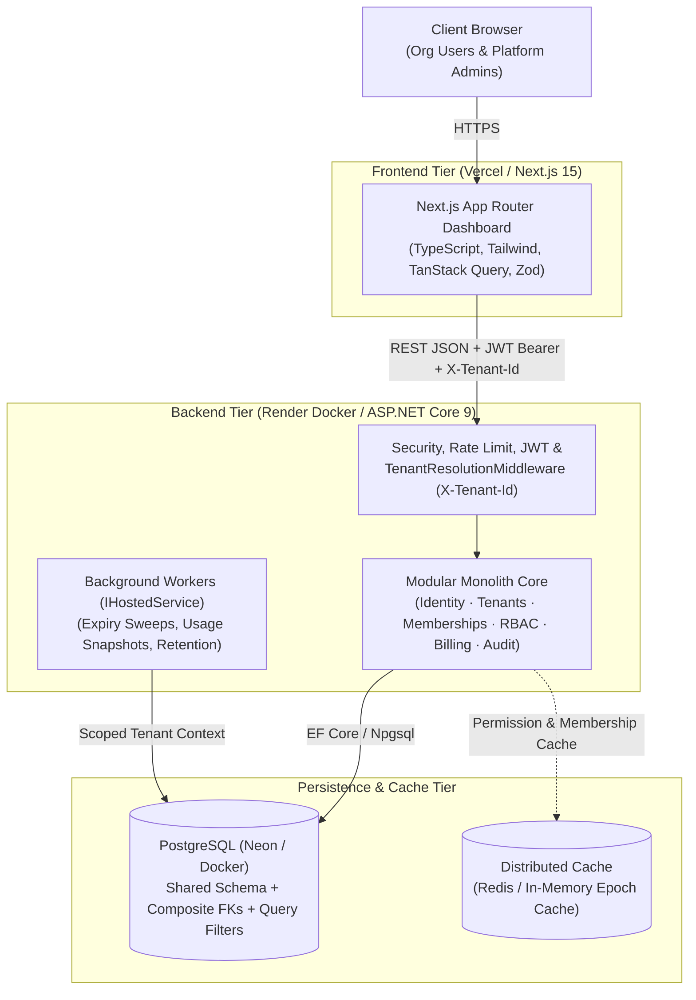
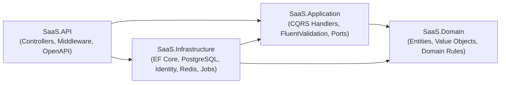
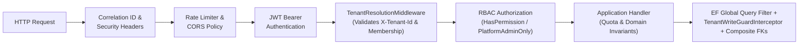

# Multi-Tenant SaaS Management Platform

[](https://multi-tenant-saa-s-seven.vercel.app/)
[](https://dotnet.microsoft.com/)
[](https://nextjs.org/)
[](https://www.postgresql.org/)
[](https://www.typescriptlang.org/)

A full-stack B2B **Multi-Tenant SaaS Management Platform** built with **Clean Architecture**, **Modular Monolith** boundaries, **ASP.NET Core (.NET 9)**, **Entity Framework Core**, **PostgreSQL**, **Redis**, and **Next.js 15 (TypeScript)**.

Designed with strict tenant isolation, fine-grained RBAC, refresh token rotation with reuse detection, subscription quota enforcement, immutable audit logging, and a complete administration dashboard.

---

## Live Demo

**[Launch Application → https://multi-tenant-saa-s-seven.vercel.app/](https://multi-tenant-saa-s-seven.vercel.app/)**

> **Note:** The live backend API is hosted on free-tier cloud infrastructure (Render + Neon PostgreSQL). If the service has been idle, the first login or API request may take ~30–50 seconds while the container wakes up.

### Demo Accounts

All seeded demo accounts use the password **`DemoPass123!`**:

| Email | Role / Workspace | What to Explore |
|---|---|---|
| `platform.admin@saas.local` | **Platform Administrator** | Platform-wide tenant management, suspend/reactivate workspaces, plan catalog |
| `alice@acme.local` | **Acme Corp** (Owner — Pro Plan) | Full tenant dashboard, member invitations, custom RBAC roles, billing, audit logs |
| `dave@globex.local` | **Globex Labs** (Owner — Free Plan) | Plan quota enforcement, isolated tenant data (completely separated from Acme Corp) |
| `consultant@demo.local` | **Multi-Tenant Member** | Tenant workspace switcher across multiple organizations |

---

## Key Features

- **Six-Layer Multi-Tenancy & Isolation:** `X-Tenant-Id` resolution middleware, EF Core Global Query Filters, composite foreign keys (`TenantId` + entity ID), `TenantWriteGuardInterceptor`, and cross-tenant IDOR protection.
- **Authentication & Session Security:** ASP.NET Core Identity, JWT bearer access tokens, refresh token rotation with automatic reuse detection (token family revocation), active session management, and endpoint rate limiting.
- **Role-Based Access Control (RBAC):** System roles, plan-gated custom roles, declarative `[HasPermission]` authorization policies, privilege escalation guards, and distributed permission caching (`IDistributedCache` / Redis).
- **Member & Invitation Lifecycle:** Secure token-hashed email invitations (invite, resend, revoke, accept), paginated/searchable member directory, role updates, and last-owner deletion protection.
- **Subscriptions, Plans & Quotas:** Tiered plans (`Free`, `Pro`, `Enterprise`), plan upgrades/cancellations, real-time seat and role quota enforcement, usage tracking middleware, and background aggregation workers.
- **Auditability & Observability:** Immutable platform and tenant audit logs, correlation ID propagation, RFC 9457 `ProblemDetails` error responses, Serilog structured logging, and `/health/live` + `/health/ready` endpoints.
- **Admin Dashboard (`frontend/`):** Responsive multi-tenant workspace UI covering Authentication, Onboarding, Overview Dashboard, Members, Roles & Permissions, Subscription & Billing, Audit Logs, Workspace Settings, and Platform Administration.

---

## Tech Stack

| Layer | Technologies |
|---|---|
| **Backend API** | .NET 9, ASP.NET Core Web API, Clean Architecture, FluentValidation, Serilog, Swagger / OpenAPI |
| **Database & Cache** | PostgreSQL, Entity Framework Core 9 (Npgsql), Redis (`StackExchange.Redis`) |
| **Frontend** | Next.js 15 (App Router), React 19, TypeScript, Tailwind CSS, TanStack Query v5, React Hook Form, Zod |
| **Testing & CI** | xUnit, Testcontainers (PostgreSQL), NetArchTest (architecture boundaries), GitHub Actions |
| **Deployment** | Vercel (Frontend), Render + Docker (Backend API), Neon (Managed PostgreSQL) |

---

## Architecture Overview

### 1. System & Cloud Topology



### 2. Clean Architecture Dependency Flow

Dependencies point strictly inward, verified automatically by **NetArchTest** rules in `SaaS.API.IntegrationTests`:



### 3. Multi-Tenant Request & Security Pipeline



---

## Solution Structure

```text
MultiTenantSaaS/
├── src/
│   ├── SaaS.Domain/              # Core entities, value objects, domain rules (zero dependencies)
│   ├── SaaS.Application/         # Use cases, CQRS handlers, FluentValidation, service ports
│   ├── SaaS.Infrastructure/      # EF Core, PostgreSQL migrations, Identity, Redis, background jobs
│   └── SaaS.API/                 # REST controllers (v1), middleware, JWT/RBAC auth, OpenAPI
├── tests/
│   ├── SaaS.Domain.UnitTests/    # Domain invariant and entity unit tests
│   ├── SaaS.Application.UnitTests/
│   └── SaaS.API.IntegrationTests/# End-to-end API, security, isolation, and NetArchTest suites
├── frontend/                     # Next.js 15 App Router TypeScript dashboard
├── docs/                         # Architecture diagrams, C4, 4+1 views, ERD, ADRs, API specs
└── docker-compose.yml            # Full-stack local orchestration (PostgreSQL, Redis, API, Frontend)
```

---

## Architecture & Documentation

- [System Overview](docs/architecture/system-overview.md)
- [Clean Architecture & SOLID Boundaries](docs/architecture/clean-architecture.md)
- [C4 System Context & Container Diagrams](docs/architecture/diagrams/c4-context-and-container.md)
- [4+1 View Model](docs/architecture/logical-view.md) (`logical`, `development`, `process`, `physical`, `scenario`)
- [Database ER Diagram](docs/database/er-diagram.md) & [PostgreSQL Design](docs/database/database-design.md)
- [Six-Layer Multi-Tenancy Security Model](docs/security/security-model.md)
- [API Conventions & Endpoint Catalog](docs/api/api-conventions.md)
- [Architecture Decision Records](docs/decisions/ADRs/)
- [Milestone Plan & Progress Report](docs/development/milestone-plan.md)

---

## Local Development

### Option A: Full Stack with Docker Compose

```bash
cp .env.example .env
docker compose up --build
```

- **Frontend:** `http://localhost:3000`
- **Backend API & Swagger:** `http://localhost:8080/swagger`
- **Health Checks:** `http://localhost:8080/health/live` & `/health/ready`

### Option B: Run Backend & Frontend Manually

1. **Configure environment and start infrastructure (PostgreSQL & Redis):**
   ```bash
   cp .env.example .env
   docker compose up -d postgres redis
   ```

2. **Build, test, and run the .NET API:**
   ```bash
   dotnet build
   dotnet test
   dotnet run --project src/SaaS.API
   ```
   *(When running via `dotnet run`, the API also listens on `http://localhost:5025`.)*

3. **Run the Next.js frontend:**
   ```bash
   cd frontend
   cp .env.example .env.local
   npm install
   npm run dev
   ```
   Open `http://localhost:3000`. If running the API via `dotnet run`, set `NEXT_PUBLIC_API_BASE_URL=http://localhost:5025/api/v1` in `frontend/.env.local`.
