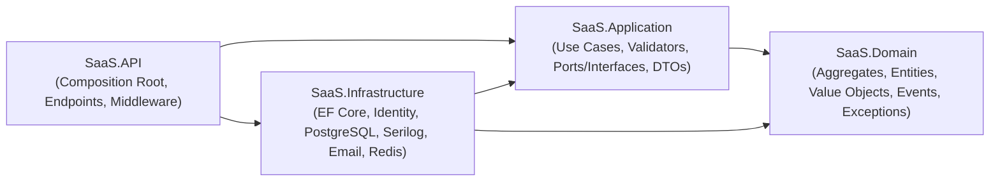

# Clean Architecture & Dependency Boundaries

## 1. Layer Topology

The backend follows strict inward-pointing dependencies across four assemblies:

### Layer Dependency Rules (Mandatory)

1. **`SaaS.Domain` (Innermost Core):**
   - **References:** None (zero project references, zero third-party NuGet packages).
   - **Contains:** Aggregate roots, entities, `TenantEntity` base class, value objects (`TenantSlug`, `EmailAddress`), domain events (`IDomainEvent`), domain exceptions (`DomainException`, `BusinessRuleViolationException`), enums, and explicit domain invariants.
   - **Forbidden:** EF Core attributes (`[Table]`, `[MaxLength]`), ASP.NET Core Identity classes (`IdentityUser`), `HttpContext`, logging frameworks, or JSON serializer attributes.

2. **`SaaS.Application` (Use Case Orchestration):**
   - **References:** `SaaS.Domain` only (plus minimal abstractions: `FluentValidation`, `Microsoft.Extensions.Logging.Abstractions`, `Microsoft.Extensions.DependencyInjection.Abstractions`).
   - **Contains:** Module-grouped commands, queries, handlers (`ICommandHandler<,>`, `IQueryHandler<,>`), FluentValidation validators, DTOs, authorization requirement metadata, application exceptions (`NotFoundException`, `ForbiddenException`, `ConflictException`, `TenantAccessDeniedException`, `QuotaExceededException`), and port interfaces (`IApplicationDbContext`, `IUnitOfWork`, `ITenantContext`, `ICurrentUser`, `IIdentityService`, `IPaymentProvider`, `IEmailService`, `IAuditLogger`).
   - **Forbidden:** Direct references to `Npgsql`, `EntityFrameworkCore` provider types, `HttpContext`, `JwtSecurityTokenHandler`, or concrete infrastructure services.

3. **`SaaS.Infrastructure` (Adapters & Persistence):**
   - **References:** `SaaS.Application` and `SaaS.Domain`.
   - **Contains:** `ApplicationDbContext`, Fluent `IEntityTypeConfiguration<T>` mappings, PostgreSQL migrations, `TenantWriteGuardInterceptor`, `ApplicationUser : IdentityUser<Guid>`, JWT token generation, `TenantMembershipResolver`, `PermissionAuthorizationHandler`, `MockPaymentProvider`, `SmtpEmailService` / `DevelopmentEmailService`, Redis caching (Phase 4), and background services.
   - **Note on EF Core in `Application` vs `Infrastructure`:** To avoid leaky abstractions while avoiding redundant generic repository boilerplate, `IApplicationDbContext` exposes `IQueryable<T>` / `DbSet`-equivalent read/write abstractions (or focused query + module persistence ports) — specifically: `SaaS.Application` uses `Microsoft.EntityFrameworkCore` *abstractions* OR clean focused module repositories/DbContext interface. Let's avoid referencing `Microsoft.EntityFrameworkCore.Relational` or `Npgsql` in Application; instead keep `SaaS.Application` independent of EF Core if practical by defining focused unit-of-work + repository/query interfaces per aggregate/module (`ITenantRepository`, `IMembershipRepository`, `IReadDbQueries` or `IApplicationDbContext`). Using small, ISP-compliant module ports (e.g., `ITenantStore`, `IMembershipStore`, `ISubscriptionStore`, `IAuditStore`, `IDashboardReadService`) guarantees `SaaS.Application` stays 100% free of EF Core packages and deeply adheres to **Interface Segregation Principle (ISP)** and **Dependency Inversion Principle (DIP)**!

4. **`SaaS.API` (Composition Root & HTTP Boundary):**
   - **References:** `SaaS.Application` and `SaaS.Infrastructure` (solely for DI registration in `Program.cs` / `DependencyInjection.cs`).
   - **Contains:** Thin versioned controllers (`Controllers/v1/...`), `Middleware/` (`CorrelationIdMiddleware`, `ExceptionHandlingMiddleware`, `TenantResolutionMiddleware`, `SecurityHeadersMiddleware`), Swagger/OpenAPI setup, CORS, Rate Limiting, Health Checks.
   - **Forbidden:** Business logic, direct `DbContext` access inside controllers, or returning domain/EF entities directly.

---

## 2. SOLID Principles Applied Across Layers

| Principle | Concrete Application in This Platform |
|---|---|
| **S — Single Responsibility** | Separate handlers per command/query (`CreateTenantCommandHandler`, `InviteMemberCommandHandler`). `TenantResolutionMiddleware` resolves and verifies membership; `PermissionAuthorizationHandler` enforces capabilities; `ExceptionHandlingMiddleware` maps exceptions to `ProblemDetails`. |
| **O — Open/Closed** | Payment integration uses `IPaymentProvider` (`MockPaymentProvider` now, `StripePaymentProvider` later without editing subscription handlers). Domain events allow adding email notifications or audit projections without altering core state transitions. |
| **L — Liskov Substitution** | Any `IPaymentProvider`, `IEmailService`, or `ICacheService` implementation honors behavioral contracts (deterministic errors, cancellation support, non-null results). |
| **I — Interface Segregation** | Split `ITenantContext` (read-only scoped tenant state) from `ITenantContextSetter` (middleware-only mutator). Split `ITenantStore`, `IMembershipStore`, `IRoleStore`, `ISubscriptionStore`, `IAuditStore` instead of one monolithic `IRepository` or bloated 30-property `IApplicationDbContext`. |
| **D — Dependency Inversion** | Application handlers depend only on domain types and narrow Application ports; Infrastructure implements those ports and is wired at `SaaS.API`. |

---

## 3. Automated Architecture Enforcement

During Phase 1 and Phase 6, `SaaS.API.IntegrationTests` (or a dedicated architecture test suite using `NetArchTest.Rules`) will assert:
- `SaaS.Domain` has zero dependencies on `SaaS.Application`, `SaaS.Infrastructure`, `SaaS.API`, `EntityFrameworkCore`, or `AspNetCore`.
- `SaaS.Application` has zero dependencies on `SaaS.Infrastructure`, `SaaS.API`, or `Npgsql`.
- Controllers depend only on Application command/query handlers (or `ISender`/dispatcher) and never inject `ApplicationDbContext`.
