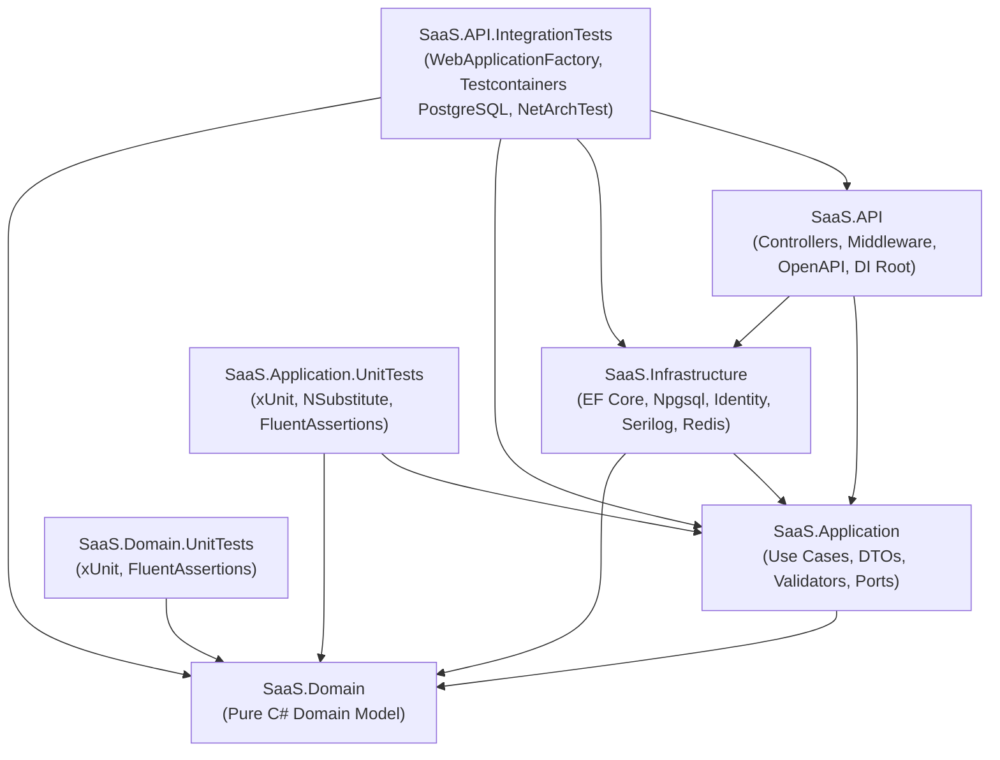

# 4+1 Development View

The Development View describes the repository layout, solution structure, assembly boundaries, package responsibilities, and build/test architecture.

---

## 1. Repository & Solution Layout

```text
MultiTenantSaaS/
├── MultiTenantSaaS.sln
├── .github/
│   └── workflows/
│       └── ci.yml
├── docker-compose.yml
├── .env.example
├── src/
│   ├── SaaS.Domain/
│   │   ├── Common/
│   │   ├── Identity/
│   │   ├── Tenants/
│   │   ├── Memberships/
│   │   ├── AccessControl/
│   │   ├── Subscriptions/
│   │   └── Audit/
│   ├── SaaS.Application/
│   │   ├── Common/
│   │   │   ├── Abstractions/
│   │   │   ├── Exceptions/
│   │   │   └── Models/
│   │   └── Modules/
│   │       ├── Identity/
│   │       ├── Tenants/
│   │       ├── Memberships/
│   │       ├── AccessControl/
│   │       ├── Subscriptions/
│   │       ├── Audit/
│   │       ├── Dashboard/
│   │       └── PlatformAdmin/
│   ├── SaaS.Infrastructure/
│   │   ├── Persistence/
│   │   │   ├── Configurations/
│   │   │   ├── Interceptors/
│   │   │   ├── Migrations/
│   │   │   └── Seed/
│   │   ├── Identity/
│   │   ├── MultiTenancy/
│   │   ├── Subscriptions/
│   │   ├── Email/
│   │   ├── Caching/
│   │   ├── BackgroundJobs/
│   │   └── Logging/
│   └── SaaS.API/
│       ├── Controllers/v1/
│       ├── Middleware/
│       ├── Extensions/
│       └── Program.cs
├── tests/
│   ├── SaaS.Domain.UnitTests/
│   ├── SaaS.Application.UnitTests/
│   └── SaaS.API.IntegrationTests/
├── frontend/
│   ├── src/app/
│   ├── src/components/
│   ├── src/features/
│   ├── src/lib/
│   └── package.json
└── docs/
```

---

## 2. Project Dependency Graph & Package Matrix



### Package Responsibilities per Project

| Project | Allowed External Packages | Responsibility |
|---|---|---|
| **`SaaS.Domain`** | **None** | Pure business domain, entities, value objects, domain events, domain exceptions. |
| **`SaaS.Application`** | `FluentValidation`, `Microsoft.Extensions.DependencyInjection.Abstractions`, `Microsoft.Extensions.Logging.Abstractions` | Commands, queries, DTOs, validation rules, authorization attributes/requirements, port interfaces. |
| **`SaaS.Infrastructure`** | `Npgsql.EntityFrameworkCore.PostgreSQL`, `Microsoft.AspNetCore.Identity.EntityFrameworkCore`, `System.IdentityModel.Tokens.Jwt`, `Serilog.AspNetCore`, `StackExchange.Redis` (Phase 4) | Persistence, migrations, ASP.NET Identity, JWT generation, tenant resolver, mock payment, email, background jobs. |
| **`SaaS.API`** | `Microsoft.AspNetCore.Authentication.JwtBearer`, `Microsoft.AspNetCore.OpenApi` / `Swashbuckle.AspNetCore`, `Asp.Versioning.Mvc` | HTTP transport, Swagger/OpenAPI, ProblemDetails error mapping, Rate Limiting, CORS, health checks. |
| **`frontend/`** | `next`, `react`, `typescript`, `tailwindcss`, `shadcn/ui`, `react-hook-form`, `zod`, `@tanstack/react-query` | Minimalist admin dashboard UI consuming the REST API. |

---

## 3. Build & Test Topology

- **Local/CI Build:** `dotnet build MultiTenantSaaS.sln` builds all 4 source projects + 3 test projects in a single pass with `<TreatWarningsAsErrors>true</TreatWarningsAsErrors>` (recommended for production hygiene) and nullable reference types enabled.
- **Unit Tests:** `SaaS.Domain.UnitTests` and `SaaS.Application.UnitTests` execute purely in memory without Docker or external I/O in sub-second time.
- **Integration & Security Tests:** `SaaS.API.IntegrationTests` boots `WebApplicationFactory<Program>` against an isolated **real PostgreSQL container** (via Testcontainers or Compose test DB), applies actual EF Core migrations, seeds multiple demo tenants, and verifies end-to-end HTTP + SQL isolation.
