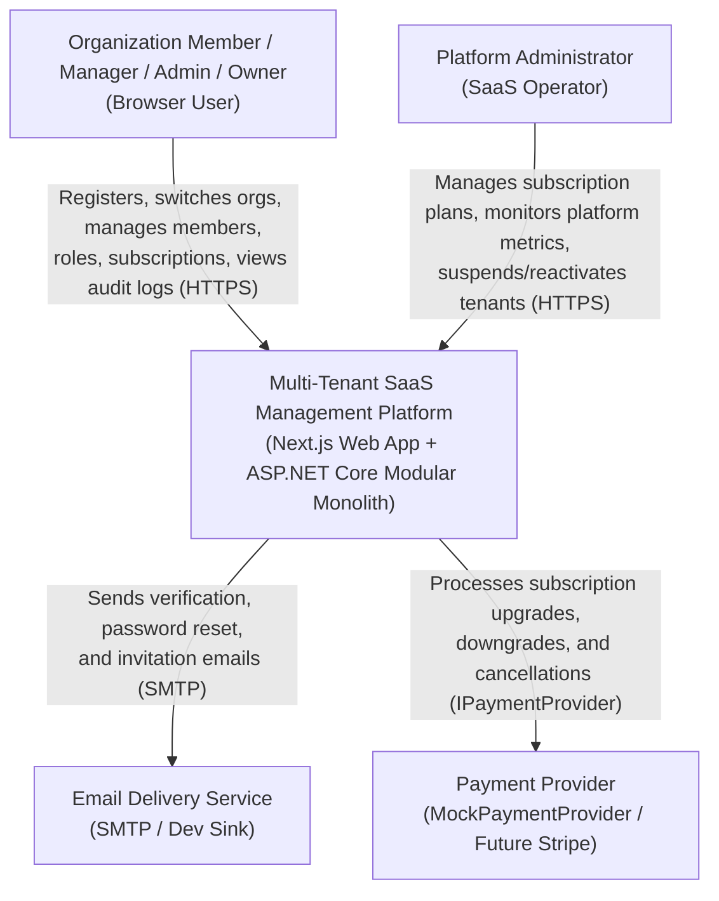
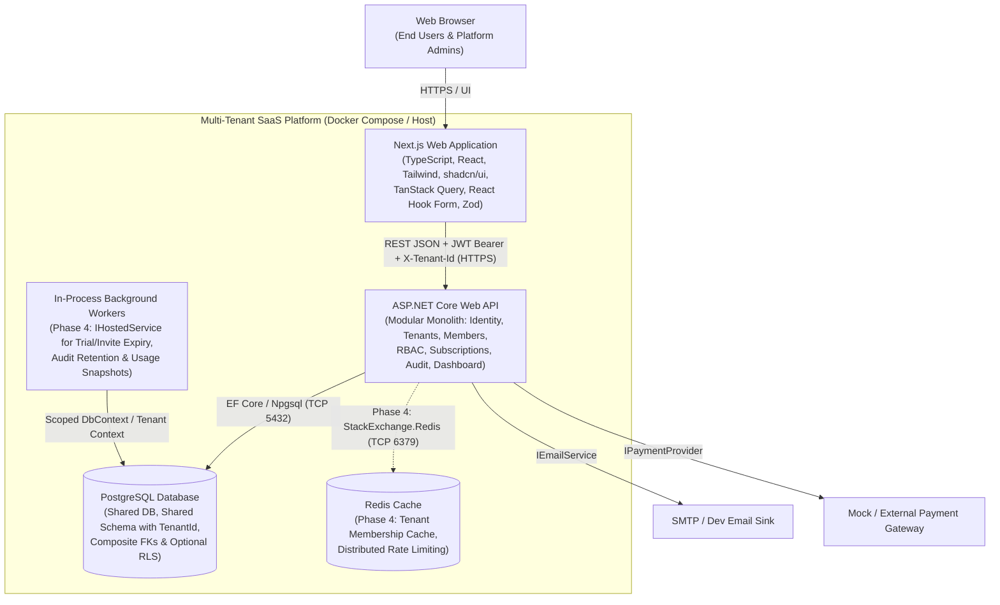

# C4 System Context & Container Diagrams

## 1. C4 Level 1 — System Context Diagram

Shows how human actors and external systems interact with the Multi-Tenant SaaS Management Platform.

---

## 2. C4 Level 2 — Container Diagram

Illustrates the runtime containers and communication protocols inside the platform boundary.

### Container Responsibilities & Boundaries

- **Next.js Web Application (`frontend/`):** Minimal, responsive B2B administration dashboard. Handles user forms (Zod validation), JWT storage/refresh orchestration, active `X-Tenant-Id` switching, and rendering backend-driven metrics. Never trusted as an authorization boundary.
- **ASP.NET Core Web API (`src/SaaS.API` + `Application` + `Domain` + `Infrastructure`):** Enforces all authentication, tenant resolution, permission authorization, quota checks, domain invariants, ACID transactions, and audit trails.
- **PostgreSQL:** Primary source of truth for identity, tenants, RBAC, subscriptions, usage snapshots, and immutable audit logs.
- **Redis (Phase 4):** Introduced only after core correctness is established — caches resolved `(UserId, TenantId)` memberships/permissions with explicit invalidation on membership/role updates, and backs distributed rate limiting.
