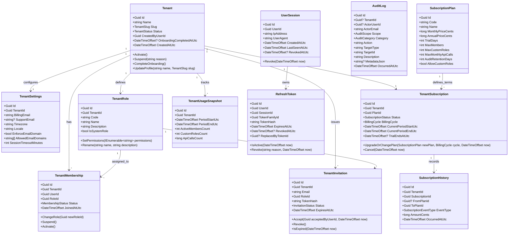

# 4+1 Logical View

The Logical View describes the functional abstractions, domain aggregates, value objects, business modules, relationships, and domain invariants inside `SaaS.Domain`.

---

## 1. Domain Model & Module Organization

---

## 2. Core Business Modules & Domain Invariants

| Module | Primary Entities / Value Objects | Key Domain Invariants |
|---|---|---|
| **Identity** | `UserSession`, `RefreshToken` (+ Infra `ApplicationUser`) | Refresh tokens are immutable once revoked; presenting a revoked token invalidates its entire `TokenFamilyId` and owning `UserSession`. |
| **Tenants** | `Tenant`, `TenantSettings`, `TenantSlug` | `TenantSlug` is lowercase alphanumeric + hyphens (`^[a-z0-9][a-z0-9-]{1,61}[a-z0-9]$`), globally unique. Suspended/Deactivated tenants cannot execute standard workspace operations. |
| **Memberships** | `TenantMembership`, `TenantInvitation`, `EmailAddress` | Every tenant must maintain at least one `Active` `Organization Owner`. Only an existing Owner can promote/demote another Owner. Pending invitations enforce `ExpiresAtUtc` and email matching on acceptance. |
| **AccessControl** | `TenantRole`, `RolePermission`, `PermissionCatalog` | System roles (`ORG_OWNER`, `ORG_ADMIN`, `MANAGER`, `MEMBER`) cannot be deleted or have their code renamed; `ORG_OWNER` retains immutable full tenant capability set. |
| **Subscriptions** | `SubscriptionPlan`, `TenantSubscription`, `SubscriptionHistory`, `TenantUsageSnapshot` | Downgrades are blocked if current active member count or custom role count exceeds target plan's `MaxMembers` / `MaxCustomRoles`. Subscriptions follow valid state transitions (`Trialing -> Active/Expired/Canceled`, `Active -> Canceled/PastDue`). |
| **Audit** | `AuditLog` | Append-only records; no public update or delete operations exist on `AuditLog`. Sensitive fields are stripped before serialization. |

---

## 3. Domain Events

Domain events (`IDomainEvent`) decouple core aggregate mutations from cross-module side effects within the same transaction or post-commit dispatch:
- `TenantCreatedDomainEvent` -> seeds audit log + onboarding notification
- `TenantSuspendedDomainEvent` -> records critical platform audit entry
- `MemberInvitedDomainEvent` -> sends invitation email via `IEmailService`
- `MembershipRoleChangedDomainEvent` -> invalidates cached permissions (Phase 4) + creates audit log
- `SubscriptionChangedDomainEvent` -> writes `SubscriptionHistory` + audit log
- `RefreshTokenReuseDetectedDomainEvent` -> revokes token family + writes high-severity security audit log
