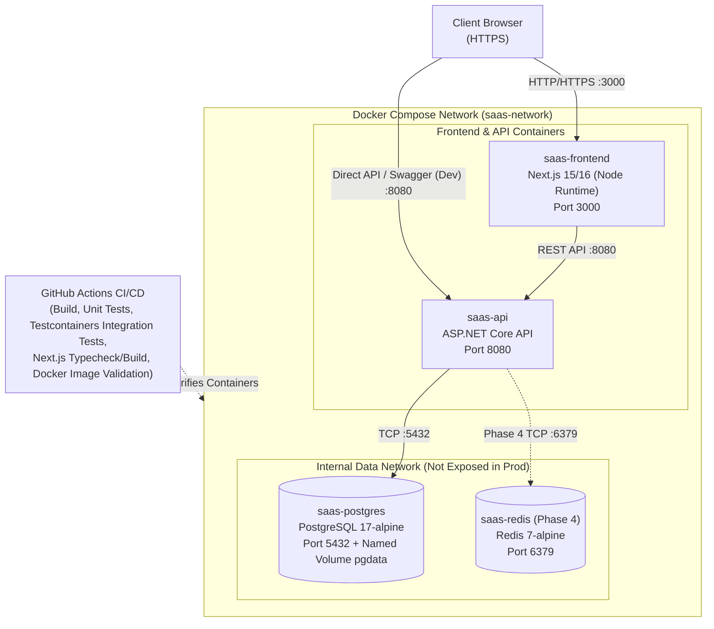

# 4+1 Physical View

The Physical View maps software containers onto infrastructure nodes, Docker services, network boundaries, and CI/CD pipelines.

---

## 1. Container & Deployment Topology

---

## 2. Environment & Secret Management Strategy

- **Zero Secrets in Repository:** `.env.example` provides structural templates only; actual secrets (`JWT_SIGNING_KEY`, `POSTGRES_PASSWORD`, `SMTP_PASSWORD`) are injected via environment variables or Docker secrets.
- **Database Credentials Isolation:** Application connects with a dedicated least-privilege PostgreSQL user (not cluster superuser in production) and executes migrations cleanly via startup migration runner (dev) or CI migration bundle/command (prod).
- **Health Checks & Readiness:**
  - `saas-postgres` defines `pg_isready` health check.
  - `saas-api` exposes `/health/live` (liveness) and `/health/ready` (verifying PostgreSQL + Redis connectivity).
  - `saas-frontend` depends on healthy `saas-api` in Docker Compose.

---

## 3. CI/CD Pipeline Flow (GitHub Actions)

1. **Trigger:** Push or Pull Request to `main` / `develop`.
2. **Backend Job:**
   - Restore & Build (`dotnet build --configuration Release`).
   - Run `SaaS.Domain.UnitTests` and `SaaS.Application.UnitTests`.
   - Run `SaaS.API.IntegrationTests` against PostgreSQL (via Testcontainers or GitHub Actions `services: postgres:17`).
3. **Frontend Job:**
   - Install dependencies (`npm ci`), type-check (`tsc --noEmit`), lint (`npm run lint`), and production build (`npm run build`).
4. **Container Verification (Phase 6):**
   - Build Docker images (`Dockerfile` for API and Frontend) and verify container startup & health checks.
