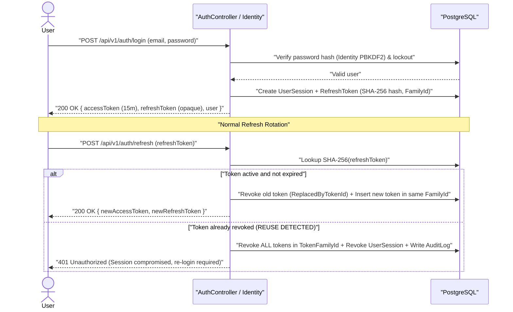

# 4+1 Process View

The Process View captures runtime interactions, concurrency, middleware request pipelines, tenant resolution, refresh token rotation, and asynchronous/background processing.

---

## 1. HTTP Request & Tenant Resolution Pipeline

Every incoming HTTP request traverses a deterministic ASP.NET Core middleware order:

```mermaid
flowchart LR
    Req["Incoming HTTP Request"] --> Corr["CorrelationIdMiddleware"]
    Corr --> Sec["SecurityHeadersMiddleware"]
    Sec --> Err["ExceptionHandlingMiddleware<br/>(RFC 9457 ProblemDetails)"]
    Err --> Rate["RateLimiterMiddleware"]
    Rate --> Cors["CORS Policy"]
    Cors --> AuthN["Authentication<br/>(JWT Bearer Validation)"]
    AuthN --> TenantRes["TenantResolutionMiddleware<br/>(Validates X-Tenant-Id & Membership)"]
    TenantRes --> AuthZ["Authorization<br/>(PermissionRequirement / PlatformPolicy)"]
    AuthZ --> Ctrl["Thin Controller -> Application Handler"]
    Ctrl --> Db["Infrastructure / PostgreSQL<br/>(Query Filter + Write Guard + Tx)"]
```

### Tenant Resolution Rules at Runtime
1. Endpoints marked `[AllowAnonymous]` or `[UserScoped]` (e.g., `/api/v1/auth/*`, `GET /api/v1/tenants`, `POST /api/v1/tenants`, `POST /api/v1/invitations/accept`) do **not** require `X-Tenant-Id`.
2. Endpoints marked `[PlatformAdminOnly]` (`/api/v1/platform/*`) require authenticated `PlatformAdministrator` claim and explicitly leave `ITenantContext` unresolved (`IsResolved = false`).
3. Tenant-scoped endpoints (`/api/v1/dashboard`, `/api/v1/members`, `/api/v1/roles`, `/api/v1/subscription`, `/api/v1/settings`, `/api/v1/audit-logs`) **require** a valid `X-Tenant-Id` GUID header:
   - Query `TenantMembership` + `Tenant.Status` + role permissions for `(CurrentUserId, RequestedTenantId)` (cached in Redis in Phase 4 with explicit invalidation).
   - If user has no active membership in `RequestedTenantId`: log a security audit event (`CROSS_TENANT_ACCESS_DENIED`) and immediately abort with `403 Forbidden`.
   - If tenant status is `Suspended` or `Deactivated`: abort with `403 Forbidden` (`ProblemDetails` detail indicating tenant status).
   - Otherwise populate scoped `ITenantContext` (`TenantId`, `MembershipId`, `RoleCode`, `Permissions`).

---

## 2. Authentication & Refresh Token Rotation Flow

---

## 3. Subscription Processing & Background Jobs (Phase 4)

- **Synchronous Subscription Change:**
  1. Handler validates tenant permissions (`billing.manage`) and checks target plan capacity against active members & custom roles inside a DB transaction.
  2. Calls `IPaymentProvider.ProcessSubscriptionChangeAsync(...)` (mock implementation in Phases 1–3/4).
  3. Updates `TenantSubscription`, appends immutable `SubscriptionHistory` row, writes `AuditLog`, and commits transaction.
- **Asynchronous Background Jobs (`IHostedService` in Phase 4):**
  - **Invitation Expiration Sweep:** Periodically marks `Pending` invitations past `ExpiresAtUtc` as `Expired`.
  - **Trial & Period Expiry Processor:** Transitions overdue trials (`TrialEndsAtUtc < now`) to `Expired` (preserving tenant context in audit logs).
  - **Usage Snapshot Flush / Audit Retention Cleanup:** Periodically aggregates API call counters from Redis/in-memory buffers into `TenantUsageSnapshot` and prunes audit logs older than the tenant's plan `AuditRetentionDays`.
  - **Tenant Context Preservation:** Background processors explicitly bind a scoped `ITenantContext` (or run with explicit `SystemJob` audit actor + target `TenantId`) per tenant batch so no tenant's records bleed into another tenant's processing loop.
