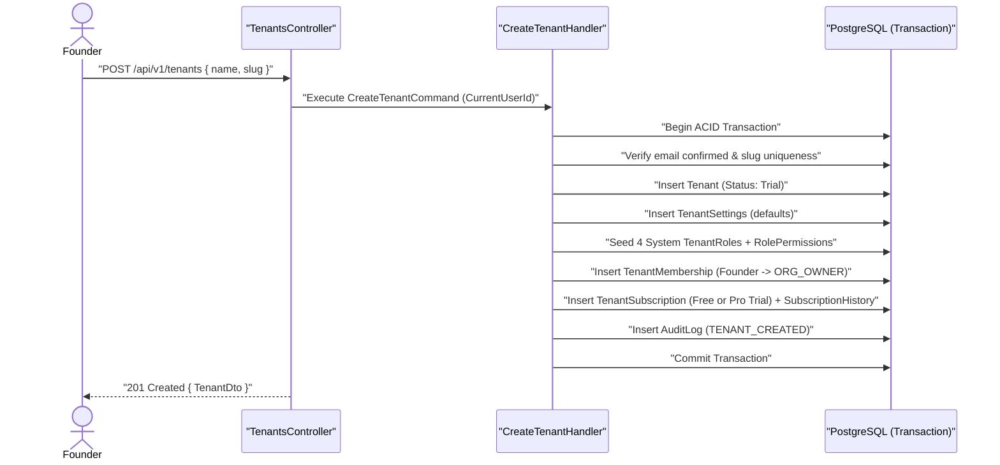
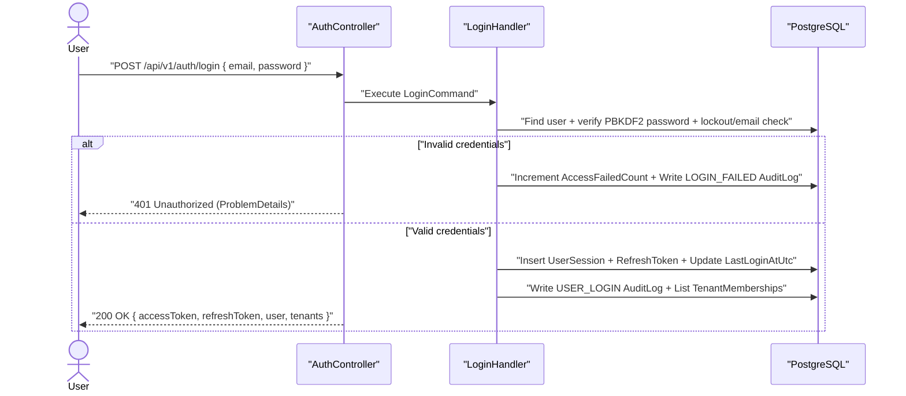
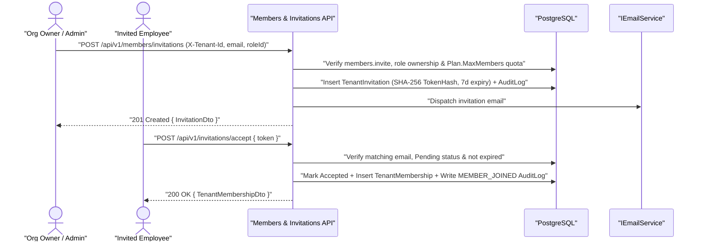
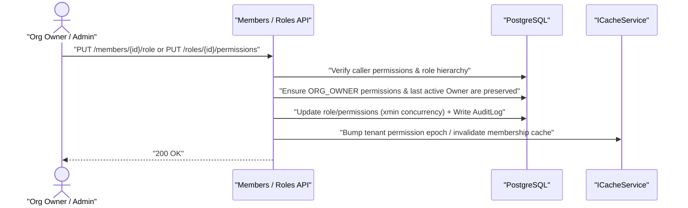
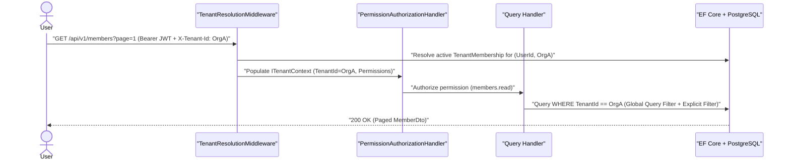
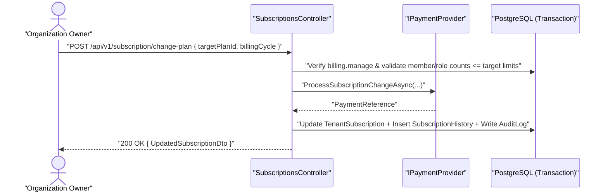
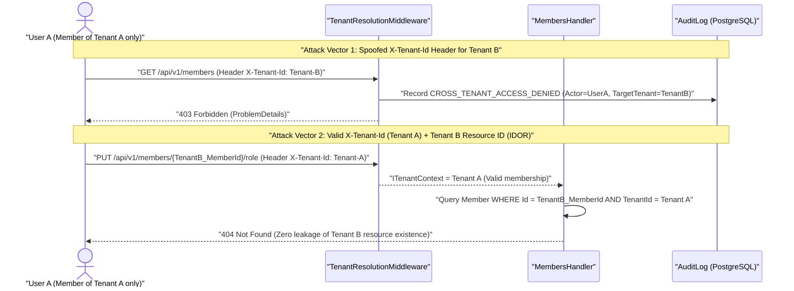

# 4+1 Scenario View (+1)

The Scenario View validates the Logical, Development, Process, and Physical architectures against seven critical end-to-end business and security scenarios.

---

## Scenario 1: New Organization Registration

---

## Scenario 2: User Login

1. Client submits `POST /api/v1/auth/login` with `{ email, password }`.
2. `LoginCommandHandler` looks up `ApplicationUser` via `UserManager`, checks `EmailConfirmed`, `IsActive`, and Identity lockout status.
3. On invalid credentials, Identity increments `AccessFailedCount`, writes `LOGIN_FAILED` audit log (without password), and returns `401 Unauthorized` (`ProblemDetails`).
4. On valid credentials, creates `UserSession` + hashed `RefreshToken`, updates `LastLoginAtUtc`, writes `USER_LOGIN` audit log, and returns JWT access token (15m) + opaque refresh token + user's tenant memberships summary.

---

## Scenario 3: Inviting an Employee

1. Organization Admin/Owner sends `POST /api/v1/members/invitations` with `X-Tenant-Id` and `{ email, roleId }`.
2. `TenantResolutionMiddleware` verifies caller has active membership in `X-Tenant-Id` and `PermissionAuthorizationHandler` verifies `members.invite`.
3. `InviteMemberHandler` verifies:
   - Target `roleId` belongs to the **same `TenantId`** and caller cannot assign a role higher than allowed (`ORG_OWNER` only assignable by an Owner).
   - Current `ActiveMembers + PendingInvitations < Plan.MaxMembers`.
   - User is not already an active member and no active pending invite exists for `(TenantId, normalizedEmail)`.
4. Persists `TenantInvitation` with SHA-256 `TokenHash`, 7-day expiry, dispatches email via `IEmailService`, and writes `MEMBER_INVITED` audit log.
5. When employee clicks invite link and calls `POST /api/v1/invitations/accept { token }` while authenticated with matching email, transaction marks invitation `Accepted`, creates `TenantMembership`, and logs `MEMBER_JOINED`.

---

## Scenario 4: Changing Member Permissions / Role

1. Organization Owner/Admin invokes `PUT /api/v1/members/{memberId}/role` or `PUT /api/v1/roles/{roleId}/permissions`.
2. **Invariants enforced:**
   - Cannot modify `ORG_OWNER` role permissions (always retains full capabilities).
   - Cannot demote or remove the **last active `ORG_OWNER`** in a tenant.
   - Non-owner cannot promote someone to `ORG_OWNER` or edit a role to contain permissions the caller does not hold.
3. Updates role/membership inside a transaction with optimistic concurrency, invalidates cached membership permissions (Phase 4), and writes `MEMBER_ROLE_CHANGED` or `ROLE_PERMISSIONS_UPDATED` audit record with before/after role metadata.

---

## Scenario 5: Accessing Tenant-Specific Resources

1. Authenticated user selects Organization A in the UI; frontend attaches `X-Tenant-Id: <OrgA-Id>` to `GET /api/v1/dashboard` or `GET /api/v1/members?page=1&pageSize=20`.
2. `TenantResolutionMiddleware` resolves `(UserId, OrgA-Id)` from `TenantMemberships`, verifies `Tenant.Status != Suspended/Deactivated`, and sets `ITenantContext`.
3. `PermissionAuthorizationHandler` checks `dashboard.read` / `members.read` against resolved `ITenantContext.Permissions`.
4. EF Core `ApplicationDbContext` applies Global Query Filter (`e.TenantId == _tenantContext.TenantId`), AND handler explicitly scopes queries to `TenantId`.
5. Returns DTO projections (`PagedResult<MemberDto>`) — never raw EF entities.

---

## Scenario 6: Subscription Upgrade

1. Organization Owner calls `POST /api/v1/subscription/change-plan { targetPlanId, billingCycle }` with permission `billing.manage`.
2. Handler validates target plan is active and (if downgrading) current active member count and custom role count fit target plan limits.
3. Calls `IPaymentProvider.ProcessSubscriptionChangeAsync(...)` (`MockPaymentProvider` generates deterministic payment reference).
4. Within ACID transaction: updates `TenantSubscription`, inserts `SubscriptionHistory` (`UPGRADED`), writes `SUBSCRIPTION_UPGRADED` audit record.
5. Next request immediately gains higher member/custom-role quotas.

---

## Scenario 7: Unauthorized Cross-Tenant Access Attempt (Security Test Case)

