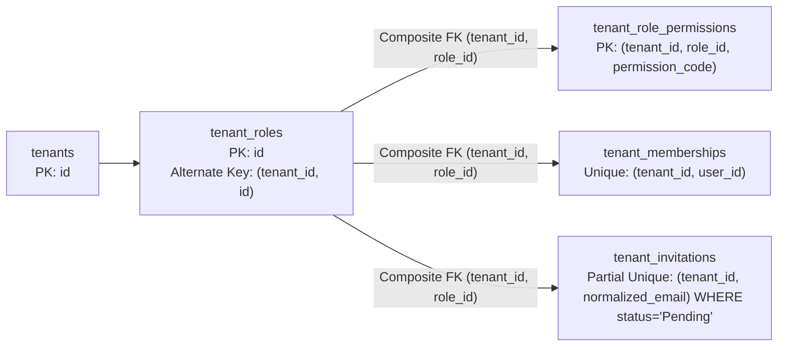

# Database Design & PostgreSQL Strategy

## 1. Core Relational Design Principles

- **Engine:** PostgreSQL (17-alpine in Docker Compose / Testcontainers).
- **Schema Strategy:** Code-First EF Core with explicit `IEntityTypeConfiguration<T>` classes (zero data annotations cluttering domain classes).
- **Naming Convention:** Lowercase `snake_case` table and column names (`EFCore.NamingConventions` or explicit fluent configuration) to avoid case-sensitive quoted SQL identifiers.
- **Primary Keys:** Application-generated UUIDv7 (`Guid.CreateVersion7()`) for sequential B-tree insert locality and zero round-trip ID generation.
- **Timestamps:** Strictly `timestamptz` stored in UTC (`DateTimeOffset` with zero offset or UTC `DateTime`).

---

## 2. Database-Enforced Tenant Integrity

> See the full schema in the [Entity-Relationship Diagram](./er-diagram.md).

Application-level query filters alone do not prevent relational bugs. The schema enforces tenant boundaries directly inside PostgreSQL:

1. **Non-Nullable `tenant_id`:** Every tenant-owned table defines `tenant_id uuid NOT NULL REFERENCES tenants(id) ON DELETE RESTRICT`.
2. **Composite Foreign Keys Preventing Cross-Tenant References:**
   - `tenant_roles` exposes a unique alternate key `(tenant_id, id)`.
   - `tenant_memberships`, `tenant_invitations`, and `tenant_role_permissions` reference `tenant_roles(tenant_id, id)` via composite FK `(tenant_id, role_id)`.
   - **Guarantee:** PostgreSQL rejects any `INSERT` or `UPDATE` attempting to link a membership or invitation in Tenant A to a role defined in Tenant B.
3. **Tenant-Scoped Uniqueness Constraints:**
   - `tenant_roles`: `UNIQUE (tenant_id, code)` and `UNIQUE (tenant_id, name)` — two tenants can both have a custom role named `"Billing Reviewer"`.
   - `tenant_memberships`: `UNIQUE (tenant_id, user_id)` — a user belongs to a given tenant at most once, while belonging to multiple tenants simultaneously.
   - `tenant_invitations`: Partial unique index `CREATE UNIQUE INDEX uq_tenant_invitations_pending_email ON tenant_invitations (tenant_id, normalized_email) WHERE status = 'Pending'` — blocks duplicate open invitations per tenant while permitting re-invites after expiration/revocation and cross-tenant invites to the same email.

---

## 3. Indexing Strategy

All tenant-scoped indexes lead with `tenant_id` so PostgreSQL narrows B-tree scans to the single tenant before filtering or sorting:

| Table | Index | Purpose |
|---|---|---|
| `tenants` | `UNIQUE (slug)` | Fast tenant lookup & slug uniqueness |
| `refresh_tokens` | `UNIQUE (token_hash)`, `(token_family_id)`, `(user_id, revoked_at_utc)` | O(1) token lookup, instant family revocation on reuse |
| `tenant_memberships` | `UNIQUE (tenant_id, user_id)`, `(user_id, status)` | Auth resolution (`X-Tenant-Id` + `UserId`) and "list my tenants" |
| `tenant_invitations` | `UNIQUE (token_hash)`, Partial `UNIQUE (tenant_id, normalized_email) WHERE status = 'Pending'`, `(status, expires_at_utc)` | Invite acceptance, duplicate guard, background expiry sweep |
| `audit_logs` | `(tenant_id, occurred_at_utc DESC)`, `(occurred_at_utc DESC)`, `(tenant_id, category, action)` | Paginated tenant activity feed & platform security queries |
| `subscription_history` | `(tenant_id, occurred_at_utc DESC)` | Tenant billing history timeline |

---

## 4. Concurrency, Transactions & Soft Deletion

- **Optimistic Concurrency:** `tenants`, `tenant_subscriptions`, `tenant_memberships`, and `tenant_roles` map PostgreSQL's built-in system column `xmin` as an EF Core concurrency token (`UseXminAsConcurrencyToken()`). Concurrent modifications to subscriptions or owner demotions fail safely with `409 Conflict` instead of silent lost updates.
- **Transaction Boundaries:** Multi-step state mutations (`CreateTenant`, `AcceptInvitation`, `ChangeSubscriptionPlan`, `RotateRefreshToken`) run inside explicit PostgreSQL transactions (`IDbContextTransaction`).
- **Soft Deletion Policy (Justified Restraint):**
  - **No blanket soft delete:** Operational records like `tenant_role_permissions` and `tenant_invitations` use explicit status machines (`Pending`, `Accepted`, `Revoked`, `Expired`) or hard deletion when unreferenced.
  - **Lifecycle Status over Soft Delete:** `tenants` and `tenant_memberships` use explicit `Status` enums (`Active`, `Suspended`, `Deactivated` / `Removed`) rather than hidden `IsDeleted` flags, ensuring state transitions are auditable and unambiguous.
  - **Immutable Tables:** `audit_logs` and `subscription_history` are append-only and never updated or deleted by user actions.

---

## 5. Query Efficiency & N+1 Prevention

- Read endpoints use `AsNoTracking()` and project directly into Application DTOs via `.Select(...)` so only needed columns cross the wire.
- Dashboard statistics execute single-round-trip aggregate `COUNT` / `GROUP BY` queries in SQL instead of loading member/audit collections into memory.
- Pagination enforces strict server-side `pageSize <= 100` caps.
