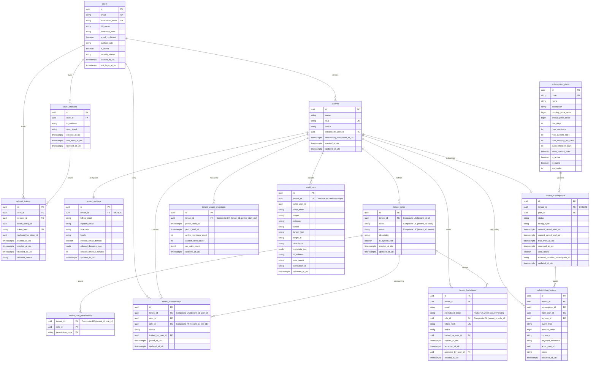

# Database Entity-Relationship (ER) Diagram

All tables use PostgreSQL snake_case naming and UTC timestamps (`timestamptz`).  
Tenant-scoped tables carry a non-nullable `tenant_id` foreign key and composite keys/constraints where cross-tenant references must be prevented at the SQL engine level.

