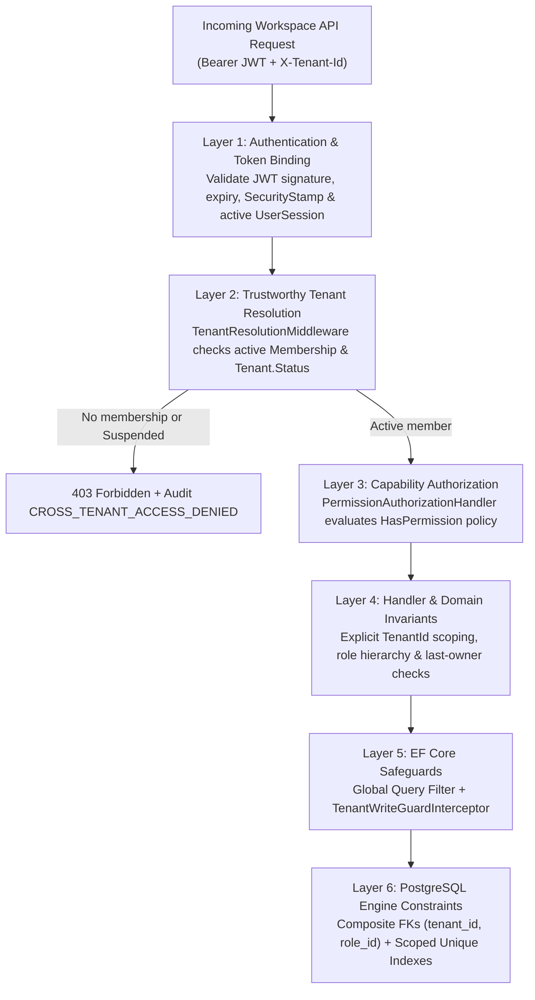

# Multi-Tenancy Security Model

Security is treated as an invariant across every layer. **EF Core global query filters are treated purely as a secondary safeguard — never as the primary security boundary.**

---

## 1. Six-Layer Defense-in-Depth for Tenant Isolation



| Layer | Mechanism | Threat Mitigated |
|---|---|---|
| **1. Authentication & Token Binding** | Short-lived JWT Bearer tokens (15 min) + SHA-256 hashed Refresh Tokens with Family Reuse Detection + SecurityStamp/Session checks. | Forged identity, stolen refresh token replay. |
| **2. Trustworthy Tenant Resolution** | `TenantResolutionMiddleware` validates `X-Tenant-Id` against `TenantMemberships` for `CurrentUserId` and verifies `Tenant.Status` is operational. | Header spoofing (`X-Tenant-Id: <OtherTenant>`). |
| **3. Capability-Based Authorization** | `[HasPermission("...")]` policy checks resolved permissions inside `ITenantContext`; Platform Admin isolated to `[PlatformAdminOnly]` routes. | Unauthorized horizontal/vertical action execution, trusting frontend roles. |
| **4. Explicit Handler & Domain Checks** | Handlers query explicitly by `(id, tenantContext.TenantId)` and enforce domain invariants (e.g., last owner protection, role hierarchy). | Insecure Direct Object Reference (IDOR), privilege escalation. |
| **5. EF Core Global Query Filters + Write Guard** | `ApplicationDbContext` applies `HasQueryFilter(e => e.TenantId == _tenantContext.TenantId)` on `TenantEntity` types; `SaveChangesAsync` write interceptor rejects inserting/modifying a `TenantEntity` whose `TenantId != _tenantContext.TenantId`. | Developer accidentally omitting `.Where(x => x.TenantId == ...)` or saving a cross-tenant record. |
| **6. PostgreSQL Relational Constraints (+ Optional RLS)** | Composite foreign keys `(tenant_id, role_id) -> tenant_roles(tenant_id, id)` and partial unique indexes scoped by `tenant_id`. Optional PostgreSQL RLS (`SET LOCAL app.current_tenant_id`) can be layered without schema redesign. | Relational corruption or cross-tenant foreign key linkage even from raw SQL bugs. |

---

## 2. Threat Model & Mitigations

### T1: Spoofing `X-Tenant-Id` Header
- **Attack:** User A (belongs only to Tenant A) sends `X-Tenant-Id: <Tenant-B-UUID>`.
- **Defense:** `TenantResolutionMiddleware` queries `TenantMemberships` for `(UserA, TenantB)` with `Status == Active`. Because no row exists, middleware immediately rejects with `403 Forbidden`, logs `CROSS_TENANT_ACCESS_DENIED` to `audit_logs`, and never enters the controller or handler.

### T2: Insecure Direct Object Reference (IDOR)
- **Attack:** User A supplies valid `X-Tenant-Id: <Tenant-A>` but passes `memberId` or `roleId` belonging to Tenant B in the URL path (`PUT /api/v1/members/{TenantB_MemberId}/role`).
- **Defense:** EF Core Global Query Filter + explicit handler filter (`x.Id == id && x.TenantId == tenantId`) guarantees zero rows match. Endpoint returns `404 Not Found` (neither leaking existence nor mutating Tenant B).

### T3: Refresh Token Theft & Replay
- **Attack:** Attacker intercepts a refresh token and uses it before or after the legitimate client.
- **Defense:** Every refresh token is single-use and belongs to a `TokenFamilyId`. Presenting a previously rotated/revoked token triggers immediate revocation of the entire token family and owning `UserSession`, forcing re-authentication and logging a security alert.

```mermaid
sequenceDiagram
    actor Client as "Legitimate Client"
    actor Attacker as "Token Thief"
    participant API as "Auth API"
    participant DB as "PostgreSQL"

    Client->>API: "POST /auth/refresh (Token T1)"
    API->>DB: "Mark T1 revoked, issue T2 (same TokenFamilyId)"
    API-->>Client: "200 OK { AccessToken, RefreshToken T2 }"

    Attacker->>API: "POST /auth/refresh (Replays old T1)"
    API->>DB: "Detect T1 already revoked -> Revoke entire TokenFamilyId & UserSession"
    API->>DB: "Write AuditLog (REFRESH_TOKEN_REUSE_DETECTED)"
    API-->>Attacker: "401 Unauthorized"

    Client->>API: "POST /auth/refresh (Uses T2)"
    API-->>Client: "401 Unauthorized (Session locked; re-login required)"
```

### T4: Privilege Escalation via Role/Membership Endpoints
- **Attack:** An `Organization Administrator` or `Manager` attempts to promote themselves to `Organization Owner` or assign `billing.manage` to a custom role.
- **Defense:**
  1. Only an active `ORG_OWNER` can assign/demote `ORG_OWNER`.
  2. Users cannot grant permissions they do not personally hold when creating or updating custom roles.
  3. Users cannot modify their own role or deactivate the last `ORG_OWNER`.

### T5: Cross-Tenant Background Job Context Bleeding
- **Attack:** A scheduled background job iterates across tenants and accidentally reuses a DbContext or `ITenantContext` from Tenant A when writing audit/usage records for Tenant B.
- **Defense:** Background jobs create an explicit `IServiceScope` per tenant iteration, set `ITenantContext` explicitly via an internal system setter (or execute cleanly without ambient tenant mutation across iterations), and log `SystemJob` as actor.

### T6: Secret & Internal Error Exposure
- **Defense:**
  - Secrets read exclusively from environment variables / `.NET User Secrets` (dev).
  - Global `ExceptionHandlingMiddleware` returns sanitized RFC 9457 `ProblemDetails` (`traceId`, generic message on `500`), never stack traces or SQL errors in Staging/Production.
  - Serilog destructuring policy and `IAuditLogger` exclude `password`, `token`, `refreshToken`, `secret`, `authorization` headers.

---

## 3. HTTP Security Controls

- **Rate Limiting (`Microsoft.AspNetCore.RateLimiting`):**
  - Strict fixed/sliding window limits on `/api/v1/auth/login`, `/register`, `/forgot-password`, `/refresh` (by IP).
  - Tenant-partitioned rate limiters for authenticated workspace APIs (Phase 4).
- **CORS:** Explicit allowlist of configured `FrontendOrigins` (`AllowCredentials` enabled only if cookie transport is used, exact methods & headers configured, never `AllowAnyOrigin()` in production).
- **Security Headers Middleware:** `X-Content-Type-Options: nosniff`, `X-Frame-Options: DENY`, `Referrer-Policy: strict-origin-when-cross-origin`, `Permissions-Policy`, HSTS in production.
